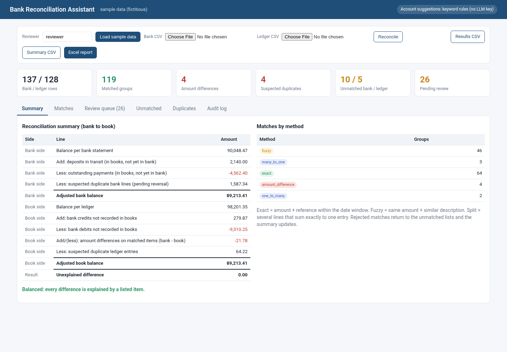
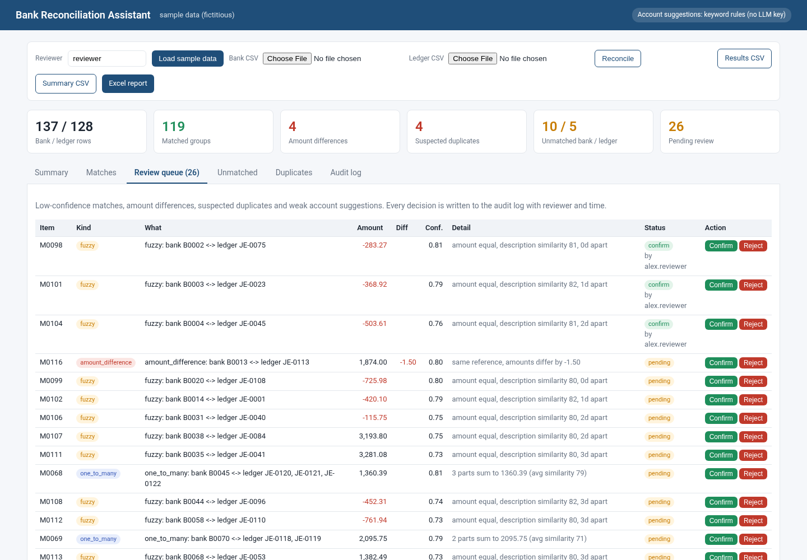
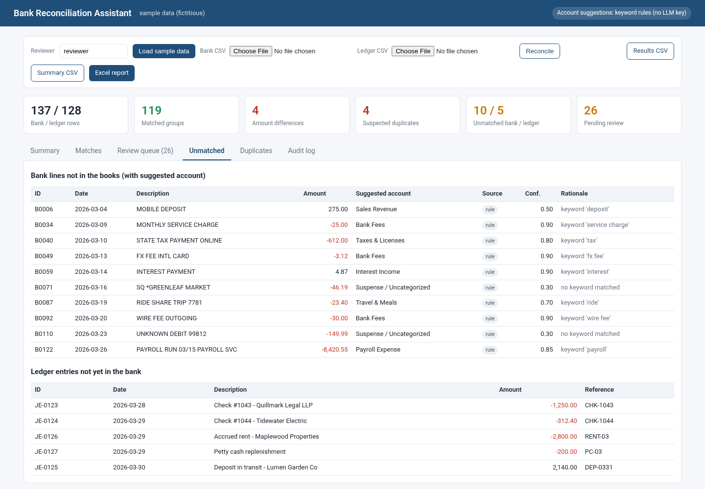
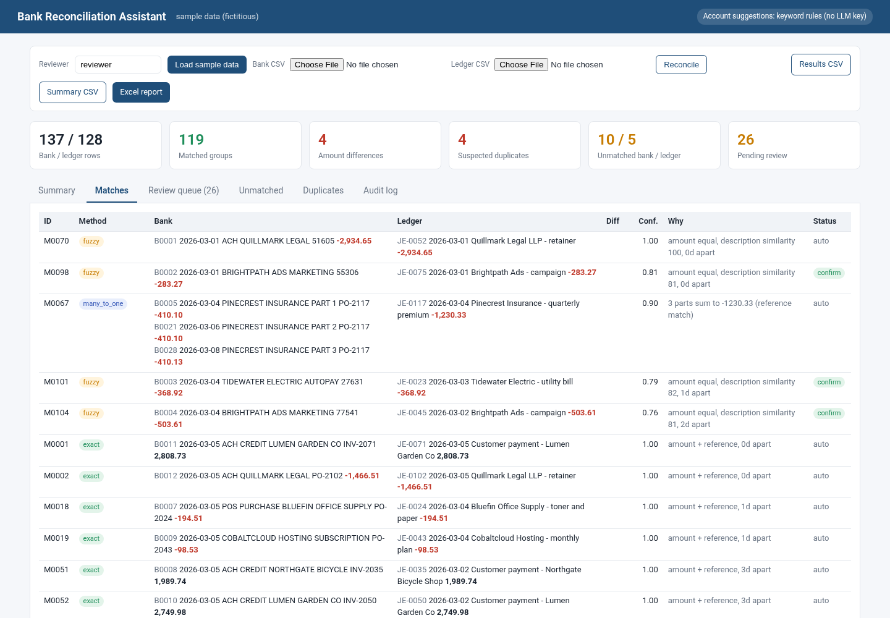
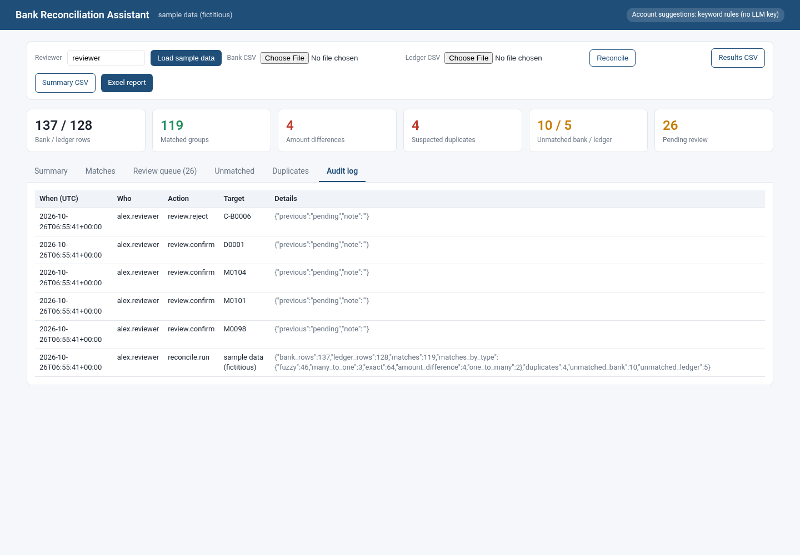
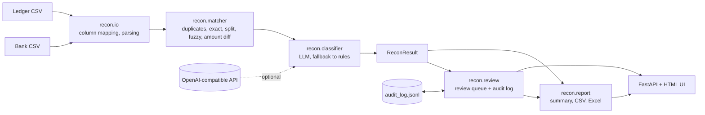

# Bank Reconciliation Assistant

Match a bank statement against the general ledger, explain every difference, and send only the exceptions to a human.

Upload two CSV files (bank statement and ledger). The app matches them automatically, suggests GL accounts for bank lines that are missing from the books, puts low-confidence items in a review queue with an audit trail, and exports a bank-to-book reconciliation summary to CSV and Excel.



## Features

- **Automatic matching** in five stages: duplicates, exact, split payments (many-to-one and one-to-many), fuzzy, and amount differences. Each match records its method, a confidence score and a plain-English reason.
- **Account suggestions** for unmatched bank lines from any OpenAI-compatible LLM (OpenAI, Azure OpenAI proxies, DeepSeek, Qwen, Ollama, vLLM and others). Without an API key, or if the call fails, keyword rules are used instead. The UI shows the source of each suggestion (`rule` or `llm`).
- **Human review queue** for low-confidence matches, amount differences, suspected duplicates and weak account suggestions. Reviewers confirm or reject each item. A rejected match goes back to the unmatched lists and the summary is recalculated.
- **Audit log** with who, when (UTC) and what for every run and every decision. It is append-only JSON Lines on disk.
- **Exports**: line-level results CSV, reconciliation summary CSV, and a formatted Excel workbook (Summary, Matched, Amount Differences, Duplicates, Unmatched, Review Queue, Audit Log).
- **Forgiving CSV import**: common header aliases (`Posting Date`, `Memo`, `Ref No`, ...), single `amount` or `debit`/`credit` columns, `(123.45)` negatives, `$` and thousands separators, several date formats.
- **Fictitious sample data** with known problems planted in it, plus a ground-truth file the tests check against.

| Review queue | Unmatched + suggested accounts |
|---|---|
|  |  |

| Matches | Audit log |
|---|---|
|  |  |

## Architecture



```
recon/
  models.py       Transaction, Match, Duplicate, Classification, ReconResult
  io.py           CSV loading and normalisation
  matcher.py      matching engine (MatchConfig holds every threshold)
  classifier.py   chart of accounts, keyword rules, LLM client with fallback
  review.py       review items, decisions, AuditLog
  report.py       bank-to-book summary, CSV and Excel export
  pipeline.py     load -> reconcile -> classify
app/
  main.py         FastAPI app (REST API + static UI)
  static/index.html
scripts/generate_sample_data.py
data/sample/      bank_statement.csv, ledger.csv, expected.json
tests/            pytest suite
```

## Matching algorithm

Amounts are signed from the company's point of view (positive = money in) and stored as `Decimal`, so sums are exact to the cent. Every stage only sees rows that earlier stages left unmatched. Candidate pairs are scored and assigned greedily from the highest score, so a row is never used twice.

| # | Stage | Rule | Confidence | Review? |
|---|---|---|---|---|
| 1 | Duplicates | Same source, same date, amount, normalised description and reference. The later copy is held back. | n/a | always |
| 2 | Exact | Equal amount, same reference (or the ledger reference appears in the bank description), dates within `date_window` (3 days). | 1.0 | no |
| 3 | Split, many-to-one | Two to four bank lines with the same sign, within `split_date_window` (10 days), related by reference or description similarity >= 45, summing **exactly** to one ledger entry. Fewest parts wins, then highest similarity. | 0.9 if all parts carry the reference, else 0.5 + 0.4 x similarity | below 0.85 |
| 3b | Split, one-to-many | Same search in the other direction: one bank deposit settling several invoices. | same | below 0.85 |
| 4 | Fuzzy | Equal amount, dates within `fuzzy_date_window` (5 days), description similarity >= `fuzzy_threshold` (70). | similarity x (1 - 0.03 x days apart) | below 0.85 |
| 5 | Amount difference | Same sign, dates within 5 days, difference <= `amount_tolerance_pct` (10%), and the same reference (or description similarity >= 90). Typical causes: bank fees deducted from wires, FX conversion, partial credits. | about 0.8 | always |

**Description similarity** uses RapidFuzz `token_set_ratio` on normalised text: lower case, punctuation removed, long digit runs (card and terminal numbers) removed, and bank noise words (`POS`, `ACH`, `PURCHASE`, ...) removed. If both descriptions start with the same distinctive word (five letters or more), the score is raised to at least 80, because bank feeds usually lead with the merchant name.

**Split search** keeps at most `max_split_candidates` (14) nearby candidates and tries combinations of two to `max_split_parts` (4) lines. That is at most about 1,500 sums per target, so it stays fast.

**Reconciliation summary** (standard bank-to-book format):

```
Balance per bank
 + deposits in transit - outstanding payments - suspected bank duplicates = Adjusted bank balance
Balance per ledger
 + bank credits not in books - bank debits not in books
 +/- amount differences on matched items - suspected ledger duplicates   = Adjusted book balance
Unexplained difference = Adjusted bank - Adjusted book   (0.00 when everything is accounted for)
```

## Install and run

Requires Python 3.10 or later.

```bash
python -m venv .venv && source .venv/bin/activate
pip install -r requirements.txt

python scripts/generate_sample_data.py      # (re)creates data/sample/
uvicorn app.main:app --reload --port 8000   # open http://localhost:8000
```

Click **Load sample data**, or upload your own two CSV files. Open `http://localhost:8000/?sample=1` to load the sample automatically.

### Input format

Bank CSV: `date, description, amount, reference` (reference is optional). Ledger CSV: `entry_id, date, description, amount, reference, account` (entry_id and account are optional). Common alternative header names and `debit`/`credit` columns are recognised.

### API

| Method | Path | Purpose |
|---|---|---|
| POST | `/api/sample` | Reconcile the bundled sample data |
| POST | `/api/upload` | multipart `bank`, `ledger`, `user` |
| GET | `/api/state` | Results, summary, review queue and audit log |
| POST | `/api/review/{item_id}` | `{"decision": "confirm" or "reject", "user": "...", "note": "..."}` |
| GET | `/api/export/results.csv`, `/api/export/summary.csv`, `/api/export/report.xlsx` | Downloads |

## Configuration

| Variable | Default | Meaning |
|---|---|---|
| `LLM_API_KEY` | (unset) | Turns on LLM account suggestions. Unset means keyword rules only. |
| `LLM_BASE_URL` | `https://api.openai.com/v1` | Any OpenAI-compatible base URL |
| `LLM_MODEL` | `gpt-4o-mini` | Model name |
| `RECON_AUDIT_LOG` | `data/audit_log.jsonl` | Audit log path |

Matching thresholds are fields of `recon.matcher.MatchConfig`.

## Tests

```bash
python -m pytest -q
```

The 28 tests cover exact, fuzzy and amount-difference matching, date windows, greedy one-to-one assignment, duplicate detection, many-to-one and one-to-many splits (exact sums, sign handling, fewest parts), keyword rules, LLM success with per-row fallback, LLM failure fallback, env configuration, CSV and Excel export, the balancing summary, review decisions with audit persistence, and the HTTP API end to end. One test runs the whole pipeline on the sample data and checks every planted problem against `data/sample/expected.json`.

## Sample data

`scripts/generate_sample_data.py` (fixed seed) creates one month for a fictitious business with invented vendor and customer names: 137 bank lines and 128 ledger entries. It plants 4 amount differences, 3 instalment payments, 2 combined customer remittances, 3 duplicated bank charges, 1 double-posted bill, 10 bank-only lines (fees, interest, payroll, unknown debits) and 5 ledger-only items (outstanding checks, a deposit in transit). The engine finds all of them: 64 exact, 46 fuzzy, 3 many-to-one, 2 one-to-many, 4 amount differences, 4 duplicates, 10 + 5 unmatched, and an unexplained difference of 0.00.

## Limitations

- Single workspace in memory: one reconciliation at a time, no user accounts. The reviewer name is typed in, not authenticated.
- Review decisions are kept in memory for the current run (the audit log is on disk). Restarting the server clears decisions.
- Split search is bounded (up to 4 parts, 14 candidates, 10-day window). Larger batch deposits need a smarter subset-sum or a bank remittance file.
- One currency per file. No FX conversion.
- Duplicate detection is exact-key. Two genuine identical purchases on the same day are flagged and need a reviewer to reject the flag.
- Keyword rules and the chart of accounts are generic examples. Adjust them for a real chart of accounts.
- The LLM path is tested with a mocked HTTP endpoint, not against a live provider.
